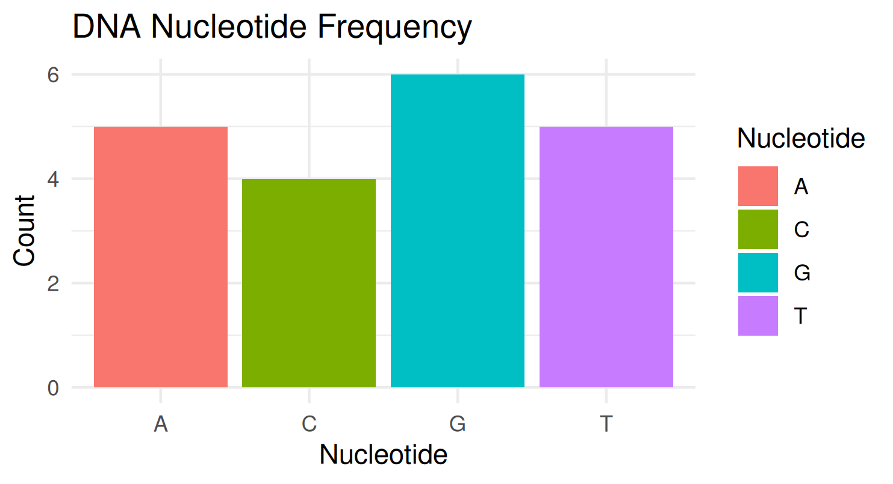
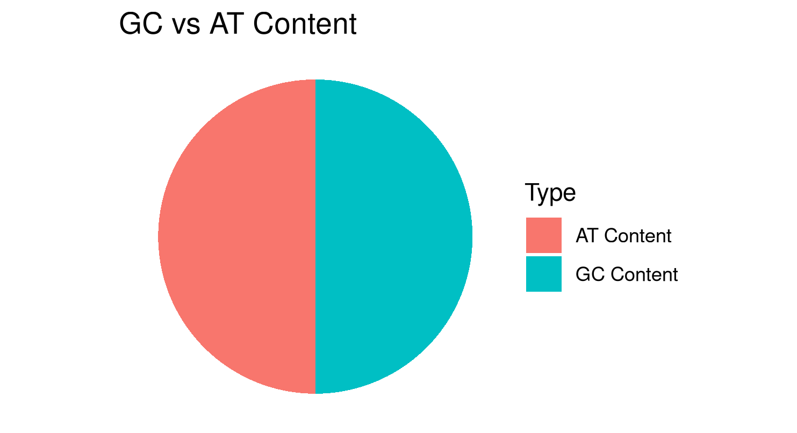

# DNA Sequence Analyzer 🧬

A beginner-friendly bioinformatics project built using R.

## Features
- DNA nucleotide frequency analysis (A, T, G, C)
- GC content calculation
- AT content calculation
- Graphical visualization of DNA sequences

## Technologies Used
- R Programming
- Posit Cloud
- Bioinformatics

## Output Graphs

### Nucleotide Frequency

### GC-AT Content

## Author
Amaan Ansari

BSc Biotechnology Student
